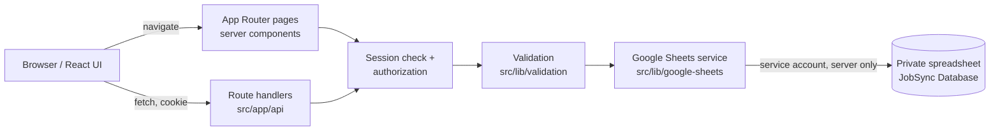

# JobSync — Architecture

Single Next.js application on Vercel. No separate backend, no microservices.

## Data flow

Browser/UI → Next.js route handlers → server-side validation and authorization → Google Sheets service → private Google spreadsheet.

## App Router structure
- `src/app/(auth)/` – login (unauthenticated layout).
- `src/app/(app)/` – Dashboard, All Jobs, Add Job, My Applications, Analytics, sharing one authenticated layout with the sidebar. The layout verifies the session server-side and redirects when absent.
- `src/app/api/` – route handlers (`auth`, `jobs`, `applications`, `analytics`, ...).
- Pages are server components by default; client components only where interaction requires it (forms, filters, charts).

## Authentication, sessions, authorization
- Login posts member + access code to a route handler. Codes are compared server-side as strings (leading zeros preserved) using constant-time comparison, from server-only env vars; they never ship in client bundles.
- On success a signed session (member ID, expiry) is stored in an HTTP-only, Secure, SameSite cookie. Logout clears it; expired or tampered sessions are rejected.
- Login is rate limited per IP+member. In-memory limiting is best-effort on serverless; this is a documented limitation acceptable for a three-person app.
- Every route handler and page derives the member identity from the session, never from request parameters. Application reads/writes are scoped to that member ID.
- Prototype access codes must be rotated/replaced with managed secrets before production.

**Phase 1 implementation:** sessions are HS256 JWTs (`jose`) in the `jobsync_session` cookie (HTTP-only, SameSite=Lax, Secure in production, default 8 h). The `(app)` layout and each page call `getSession()` and redirect to `/login` when the token is missing, expired, tampered or names an unknown member; no browser-supplied name or member ID is ever trusted. State-changing auth routes reject cross-origin requests (Origin must match Host). Rate limit: 5 failures per IP+member per 15 minutes, then 429 with `Retry-After`. Production fails closed when access codes or `SESSION_SECRET` are not configured.

## Route handlers
Each handler: authenticate → parse and validate input → authorize → call service → return a consistent JSON envelope (`{ data }` or `{ error: { code, message } }`) with proper status codes (400/401/403/404/409/429/500/503). Errors are mapped from service errors; internals are never leaked.

## Google Sheets service (`src/lib/google-sheets/`)
- Server-only module (`server-only` import) holding the service-account client built from env vars.
- Typed repositories per tab convert rows ↔ typed objects, validate each row, and skip/flag malformed rows without crashing.
- Retries with exponential backoff on 429/5xx; clear error types for API failures.

## Spreadsheet tabs and relationships
- `Jobs` (shared): one row per job, key `JobID`; `AddedBy` → `Members.MemberID`.
- `Applications`: one row per (`JobID`, `MemberID`) pair; links to `Jobs` and `Members`.
- `Members`: the three members; `Photo` references files in `public/assets/`; no secrets.
- `Activity`: append-only log (`MemberID`, `Action`, `JobID`, `Timestamp`).

**Shared jobs vs. personal status:** jobs are shared by all; application status is stored per member. The UI shows only the logged-in member's status; other members' application rows are never returned.

## Dashboard and analytics
Computed server-side from sheet data for the logged-in member: shared job count, personal application counts, pending/in-progress, daily target (10 jobs/member, from `Activity`/`Jobs.AddedAt`), contribution per member (counts of jobs added only), response rate, distributions by type/company/location/experience, trend over time, deadlines. Empty data yields empty states, never placeholders.

## Validation, IDs, timestamps, duplicates, concurrency
- Validation at the route boundary (schema library, see techstack) and again on row read.
- IDs are generated server-side (UUID/ULID); timestamps are ISO 8601 UTC.
- Duplicate URLs detected on normalized URLs (lowercased host, stripped tracking params and trailing slash); duplicates return 409.
- Sheets has no transactions. Concurrent appends can race (duplicate check vs. write, or two updates to one row). Mitigations: re-check before write, update by row lookup immediately before writing, serialize writes per instance, and accept a small residual risk documented in tests.

## Logging
Structured server logs of route, status, member ID and error codes. Never log access codes, session tokens, private keys or full request bodies.

## Limitations from direct spreadsheet edits
Owners can edit the sheet by hand. Hand edits may introduce malformed rows, duplicate IDs, renamed headers or deleted rows. The service validates headers and rows, ignores bad rows with a logged warning, and the docs state the sheet should only be edited with care.

## Why Google Sheets is the only datastore
Three users, low volume, zero hosting cost, and the owner can inspect data directly. Adding a database would add operational overhead with no benefit at this scale. Supabase, PostgreSQL, Prisma and other databases are prohibited in the initial version. Revisit if volume or concurrency outgrows Sheets.

## Testing
Unit tests (validation, calculations), integration tests of route handlers with a mocked Sheets client, end-to-end tests for critical flows. See techstack.md.

## Deployment
Vercel hosts the single Next.js app. Secrets live in Vercel environment variables (server-only). The spreadsheet is shared only with the service-account email. Deployment is gated on Phase 5.
