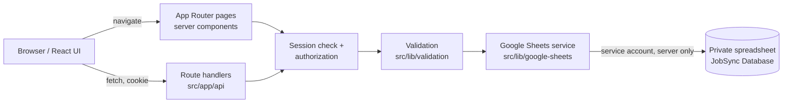

# JobSync — Architecture

Single Next.js application on Vercel. No separate backend, no microservices.

## Data flow

Browser/UI → Next.js route handlers → server-side validation and authorization → Google Sheets service → private Google spreadsheet.

## App Router structure
- `src/app/(auth)/` – login (unauthenticated layout).
- `src/app/(app)/` – Dashboard, All Jobs, Add Job, My Applications, Analytics, sharing one authenticated layout with the sidebar. The layout verifies the session server-side and redirects when absent.
- `src/app/api/` – route handlers (`auth`, `jobs`, `applications`, `analytics`, ...).
- Pages are server components by default; client components only where interaction requires it (forms, filters, charts).

## Authentication, sessions, authorization
- Login posts member + access code to a route handler. Codes are compared server-side as strings (leading zeros preserved) using constant-time comparison, from server-only env vars; they never ship in client bundles.
- On success a signed session (member ID, expiry) is stored in an HTTP-only, Secure, SameSite cookie. Logout clears it; expired or tampered sessions are rejected.
- Login is rate limited per IP+member. In-memory limiting is best-effort on serverless; this is a documented limitation acceptable for a three-person app.
- Every route handler and page derives the member identity from the session, never from request parameters. Application reads/writes are scoped to that member ID.
- Prototype access codes must be rotated/replaced with managed secrets before production.

**Phase 1 implementation:** sessions are HS256 JWTs (`jose`) in the `jobsync_session` cookie (HTTP-only, SameSite=Lax, Secure in production, default 8 h). The `(app)` layout and each page call `getSession()` and redirect to `/login` when the token is missing, expired, tampered or names an unknown member; no browser-supplied name or member ID is ever trusted. State-changing auth routes reject cross-origin requests (Origin must match Host). Rate limit: 5 failures per IP+member per 15 minutes, then 429 with `Retry-After`. Production fails closed when access codes or `SESSION_SECRET` are not configured.

## Route handlers
Each handler: authenticate → parse and validate input → authorize → call service → return a consistent JSON envelope (`{ data }` or `{ error: { code, message } }`) with proper status codes (400/401/403/404/409/429/500/503). Errors are mapped from service errors; internals are never leaked.

## Google Sheets service (`src/lib/google-sheets/`)
- Server-only module (`server-only` import) holding the service-account client built from env vars.
- Typed repositories per tab convert rows ↔ typed objects, validate each row, and skip/flag malformed rows without crashing.
- Retries with exponential backoff on 429/5xx; clear error types for API failures.

## Spreadsheet tabs and relationships
- `Jobs` (shared): one row per job, key `JobID`; `AddedBy` → `Members.MemberID`.
- `Applications`: one row per (`JobID`, `MemberID`) pair; links to `Jobs` and `Members`.
- `Members`: the three members; `Photo` references files in `public/assets/`; no secrets.
- `Activity`: append-only log (`MemberID`, `Action`, `JobID`, `Timestamp`).

**Shared jobs vs. personal status:** jobs are shared by all; application status is stored per member. The UI shows only the logged-in member's status; other members' application rows are never returned.

## Dashboard and analytics
Computed server-side from sheet data for the logged-in member: shared job count, personal application counts, pending/in-progress, daily target (10 jobs/member, from `Activity`/`Jobs.AddedAt`), contribution per member (counts of jobs added only), response rate, distributions by type/company/location/experience, trend over time, deadlines. Empty data yields empty states, never placeholders.

## Validation, IDs, timestamps, duplicates, concurrency
- Validation at the route boundary (schema library, see techstack) and again on row read.
- IDs are generated server-side (UUID/ULID); timestamps are ISO 8601 UTC.
- Duplicate URLs detected on normalized URLs (lowercased host, stripped tracking params and trailing slash); duplicates return 409.
- Sheets has no transactions. Concurrent appends can race (duplicate check vs. write, or two updates to one row). Mitigations: re-check before write, update by row lookup immediately before writing, serialize writes per instance, and accept a small residual risk documented in tests.

## Logging
Structured server logs of route, status, member ID and error codes. Never log access codes, session tokens, private keys or full request bodies.

## Limitations from direct spreadsheet edits
Owners can edit the sheet by hand. Hand edits may introduce malformed rows, duplicate IDs, renamed headers or deleted rows. The service validates headers and rows, ignores bad rows with a logged warning, and the docs state the sheet should only be edited with care.

## Why Google Sheets is the only datastore
Three users, low volume, zero hosting cost, and the owner can inspect data directly. Adding a database would add operational overhead with no benefit at this scale. Supabase, PostgreSQL, Prisma and other databases are prohibited in the initial version. Revisit if volume or concurrency outgrows Sheets.

## Testing
Unit tests (validation, calculations), integration tests of route handlers with a mocked Sheets client, end-to-end tests for critical flows. See techstack.md.

## Deployment
Vercel hosts the single Next.js app. Secrets live in Vercel environment variables (server-only). The spreadsheet is shared only with the service-account email. Deployment is gated on Phase 5.

## Phase 2 implementation (data layer)

### Modules (`src/lib/google-sheets/`, all `server-only`)
| Module | Responsibility |
|---|---|
| `config.ts` | Reads/validates `GOOGLE_SHEETS_SPREADSHEET_ID`, `GOOGLE_SERVICE_ACCOUNT_EMAIL`, `GOOGLE_PRIVATE_KEY`, `APP_TIMEZONE`. Errors name variables, never values. |
| `client.ts` | `SheetsClient` interface (get/append/update) over `@googleapis/sheets` with a JWT service account, 10 s timeout, retry with backoff (250/500 ms, 3 attempts) for 429/5xx/timeouts on reads and updates, and Google-error to `SheetsError` mapping. Appends are not auto-retried (an ambiguous failure could duplicate a row). Writes use `valueInputOption: RAW`. |
| `schema.ts`, `table.ts` | Tab names, exact headers, A1 ranges; whole-tab reads that verify the header row first and never repair it. |
| `rows.ts`, `repositories.ts` | Row to typed object parsing/serialising; skip-and-report handling of malformed rows (`RowIssue`), blank rows ignored, first row wins for duplicate keys. |
| `jobs-service.ts`, `applications-service.ts`, `activity-service.ts`, `members-service.ts`, `status-service.ts` | Business rules (below). |
| `lock.ts`, `ids.ts`, `errors.ts` | In-process write lock, `job_<uuid>`/`act_<uuid>` IDs, `SheetsError` and `DomainError`. |

Validation lives in `src/lib/validation/` (`jobs.ts`, `applications.ts`, `auth.ts`), URL/date helpers in `src/lib/utils/`, shared types in `src/types/domain.ts`. The HTTP layer is `src/lib/api/` (`protectedRoute` wrapper and response helpers).

### Routes (all require a valid session; handlers are thin)
| Route | Behaviour |
|---|---|
| `GET /api/jobs` | Shared jobs, newest first, each with **only the caller's** `myStatus`. `meta.skippedRows` counts malformed rows. |
| `POST /api/jobs` | Validates and creates a job; `AddedBy` is the session member. 201, or 400/409. |
| `GET /api/applications` | The caller's own application records only. |
| `PUT /api/applications/[jobId]` | Sets the caller's own status/stage/notes for that job. |
| `GET /api/sheets/status` | Read-only tab/header/row-health report, no credentials or cell contents. |

There is deliberately no delete route and no route that takes a `MemberID`: a member is "Not Applied" again by moving their own row back to that status.

`protectedRoute` order: same-origin check (mutations) -> session -> member is Active in the `Members` tab -> handler. Responses are `{ data, meta? }` or `{ error: { code, message, details? } }` with `Cache-Control: no-store`.

### Error mapping
| Failure | HTTP | `error.code` |
|---|---|---|
| No/invalid session | 401 | `unauthenticated` |
| Cross-origin mutation, inactive member | 403 | `forbidden`, `member_inactive` |
| Invalid body/ID (field messages only, no echoed values) | 400 | `validation_failed`, `invalid_json` |
| Body > 16 KB | 413 | `payload_too_large` |
| Unknown job | 404 | `job_not_found` |
| Duplicate URL / disallowed status change | 409 | `duplicate_url`, `invalid_transition` |
| Missing/malformed config, wrong headers or missing tab | 503 | `data_service_unavailable` |
| Quota (429) | 503 + `Retry-After` | `data_service_unavailable` |
| Credentials rejected, not shared, spreadsheet missing, upstream 5xx | 502 | `data_service_unavailable` |
| Timeout | 504 | `data_service_unavailable` |
| Anything else | 500 | `internal_error` |

Messages are fixed, safe strings; upstream messages, stack traces and secrets are never returned. When Sheets is unavailable the API fails; it never falls back to sample data.

### Ownership and independence
The member comes only from the validated session (`getSession()`); request bodies are strict schemas, so a `memberId` (or `addedBy`) field is rejected with 400. `setApplicationStatus(memberId, jobId, ...)` reads and writes only the row whose key is exactly `(jobId, memberId)`, so Anni's update cannot change Lukky's or Rishii's rows, and list endpoints filter to the caller before returning anything.

### Duplicates, IDs, timestamps
- Job URL duplicates are detected on a normalised form (scheme ignored, lower-case host without `www.`, default ports/fragments/tracking parameters/trailing slashes removed, query sorted). The original URL is stored as entered.
- `(JobID, MemberID)` is unique in the application path (update-in-place; append only when no row exists). If a hand edit creates duplicates, the first row wins and the rest are reported as issues.
- IDs are server-generated UUIDs; stored timestamps are ISO 8601 UTC; `Activity.Date` uses `APP_TIMEZONE`.

### Concurrency (limits stated plainly)
Sheets has no transactions or unique constraints, and a batch call is not a transaction. Mitigations: every read-check-write runs under an in-process lock and re-reads the tab immediately before writing, updates target one exact row range (never a whole-sheet rewrite), and the activity log is append-only. **Remaining risks:** (1) the lock is per server instance, so two serverless instances could both pass a duplicate check and append the same URL/application at the same moment; (2) a person editing the sheet by hand between the read and the write is not coordinated; (3) a failed Activity append after a successful primary write leaves a missing activity row (logged, not retried); (4) rows with malformed fields are invisible to duplicate detection. For a three-person team these are rare and visible in the sheet; they are accepted for the initial version.

### Verified vs unverified
Verified by automated tests with a mocked Sheets client. **Not verified live**: no spreadsheet or credentials were available, so the real Google API calls, permissions and quotas have not been exercised.

## Phase 3 implementation (job management screens)

### Pages (server components load data, client components handle interaction)
| Page | Server side | Client side |
|---|---|---|
| `/all-jobs` | `loadForMember(listJobsForMember)` | `JobsBrowser`: summary cards, search, Company/Location/Job Type/Experience/Status filters, Reset, sort (Deadline, Added On), 10-per-page pagination, details dialog, Applied/Not Applied toggle, row actions menu |
| `/add-job` | `loadForMember(listJobsForMember)` (recent jobs and location suggestions) | `AddJobForm`: validation with the same Zod schema as the server, Clear, submit, duplicate-link handling, Recently Added panel |
| `/my-applications` | `loadForMember(listMyApplications)` | `ApplicationsBrowser`: search, filters, sort (Applied On, Deadline), pagination, update dialog (status/stage/notes), details dialog. No charts |

`src/lib/pages/load.ts` (`loadForMember`) is the single entry for page data: it reads the **session** (redirects to `/login` without one), checks the member is Active in the `Members` tab, runs the loader with the session's member, and converts data-layer failures into a safe `{ ok: false, title, message }` that the page shows as an error state. It never substitutes sample data. Pages pass the display timezone and today's date to client components so server and client render identical dates.

### How changes persist
Every control that changes data calls an existing server route and updates the UI only from the server's response:
- Applied/Not Applied toggle and the update dialog: `PUT /api/applications/[jobId]` (body: `status`, optional `applicationStage`, `notes`; never a member ID).
- Add Job: `POST /api/jobs` (never sends `addedBy`, `addedAt` or an ID; the server sets them from the session and clock).

There is no client-side persistence and no optimistic write: a failed request leaves the old state and shows the server's message.

### Product rules implemented
- **One personal indicator.** All Jobs shows a green tick (applied) or red cross (not applied) for the signed-in member only. Statuses beyond `Applied` (In Progress, Interview, Offer, Rejected) show the tick but are locked in All Jobs and managed from My Applications.
- **Summary cards (derived from the member's real records):** Total = all shared jobs; Applied = status other than Not Applied; Pending = Applied, In Progress or Interview (no final outcome yet); Not Applied = total minus applied.
- **My Applications** lists the member's own rows whose status is not `Not Applied`, joined with the shared job. Moving a job back to Not Applied removes it from this page. Applications whose job was deleted by hand in the sheet are hidden and counted.
- **Empty states, never invented data:** an empty sheet shows "No jobs yet" with an **Add New Job** button (same label as the header button) and zero counts; My Applications shows "No applications yet" with a link to All Jobs. A failing data layer shows an error state.
- **Status filter:** "Applied" in All Jobs means any applied status; in My Applications it means exactly `Applied`.
- **Search** matches every typed word (case-insensitive) in title, company, location, type, work mode, experience, salary and description. The top-bar search box navigates to `/all-jobs?q=...` (Ctrl/Cmd+K focuses it).
- **Theme:** the signed-in member's accent colour (Anni blue, Lukky yellow, Rishii red) drives primary buttons, pagination and the active nav item through `--color-accent-strong` / `--color-on-accent`, chosen to meet WCAG AA contrast.
- **Header:** the Log out button sits just left of the account (photo and name), which is pinned to the far top-right.
- **Links:** job links open in a new tab with `rel="noopener noreferrer nofollow"`; only http(s) URLs are ever stored or rendered.

### Limitations (Phase 3)
Search, filtering and pagination run in the browser over all jobs loaded from Sheets (fine at this scale; each page load re-reads the tabs). Edits made directly in the sheet appear after a reload. Other members' status changes are not pushed live. The bell icon and "Online" indicator from the reference screenshots are intentionally omitted because there is no notification or presence feature. Dashboard and Analytics arrive in Phase 4.

## Phase 4 - Dashboard, Analytics, follow-ups, retention

### Counting rules (single source: `src/lib/counting.ts`)
Total Jobs = distinct jobs in `Jobs`. Total Applications = distinct jobs the member has not left at Not Applied. **Applied includes pending** (Pending is a subset, never added on top). Pending = applied with no known outcome (Applied, In Progress or Interview without an Offer). Shortlisted / Interviewed / Offers / Rejected come from the persisted stage and status; each application counts once per category and unknown stages never inflate a number. Not Applied = shared jobs - applied. **Rejected** = status Rejected, or the 7-day follow-up was answered "No update yet" and the application never reached Shortlisted/Interview/Offer (not shortlisted after follow-up); such an application is no longer pending. **Analytics "Total Applications" = every job available to the team** (added by all members, not limited by the date range); Applied, In Progress, Shortlisted, Interviewed, Offers and Rejected are the member's own, for the chosen range. Team totals are separate from personal ones; no other member's application data reaches the client.

### 7-day follow-up (`src/lib/follow-ups`, `follow-up-service.ts`)
The timer is the server-recorded `AppliedAt` (UTC). A job is due when `now >= AppliedAt + 604,800 s`. A blocking modal (cannot be dismissed, sequential for several due jobs) asks "What's the current status of this application?": shortlisted (stage Shortlisted), interview call (status Interview), offer (status and stage Offer) or no update (answer only). Advanced stages are never downgraded; an answered question is never asked again; Not Applied / Interview / Offer / later stages are suppressed; a failed save keeps the modal open; identity comes only from the session. Answers live in two optional trailing `Applications` columns, `FollowUpAnswer` (H) and `FollowUpAnsweredAt` (I). **Manual step on the live sheet:** add the headers `FollowUpAnswer` and `FollowUpAnsweredAt` in `Applications!H1:I1`; until then the feature is off and nothing breaks.

### 30-day retention (`retention-service.ts`, `GET /api/cron/retention`)
A job is deleted 30 days after its original `AddedAt`, together with its application rows; Activity rows keep their history but have the JobID cleared (no orphans). A missing or invalid timestamp never deletes anything. The route needs `Authorization: Bearer $CRON_SECRET`, is a **dry run by default**, and only deletes when `RETENTION_CLEANUP_ENABLED=true` (at most 100 jobs per run). Cleanup against the real spreadsheet stays disabled until the owner has reviewed a dry run.

### Activity and timeline
Events are recorded server-side: `login`, `visit` (at most one per member per 30 minutes, only after the session is validated), `job_added`, `job_applied`, `job_unapplied`, `application_updated`, `follow_up_answered`, `job_updated`, `job_deleted`. **Meaningful (work) actions** are everything except `login` and `visit`; visits are never work and no "time spent" is claimed. The Application Timeline heatmap shows the current calendar quarter (Mon-Sun weeks; Oct-Dec 2026, then Jan-Mar 2027, ...). Hover, focus or tap a day for: Date, **Job Added** (jobs the member added that day, from `Jobs.AddedBy`/`AddedAt`), **Job Applied** (distinct applications marked Applied that day, from `AppliedAt`) and **Streak** (consecutive days ending on that date with at least one work action, calculated as of that date and never using later activity). Repeated identical events (same action, job and timestamp) count once in the intensity.

### AppliedAt and legacy rows
`AppliedAt` is stamped by the server the first time a member marks a job Applied. Rows without a valid `AppliedAt` (hand-made, or older than the column) are handled by one rule, `effectiveAppliedAt` (`src/lib/applications/applied-date.ts`): recorded `AppliedAt`, else the row's `LastUpdated`, else no date (nothing is invented). Dashboard, Analytics and the timeline's Job Applied count all use it, so they agree. **The follow-up never uses the fallback**: a row with no valid `AppliedAt` is never prompted (it is counted as `invalid`), so a legacy row cannot trigger an early or guessed question. The first later update of such a row stamps `AppliedAt` with the real time, and the 168-hour clock runs from then.

### Deadlines
Only jobs the member has not applied to, nearest first; "due today" means the deadline date equals today in `APP_TIMEZONE`; missing or invalid deadlines are never invented (they are only counted).

### Live updates, edit and delete
Open pages re-fetch every `NEXT_PUBLIC_AUTO_REFRESH_MS` (default 30 s) and when the tab regains focus. `PUT/DELETE /api/jobs/[jobId]` are owner-only (`not_job_owner`, 403), enforced on the server.

### Responsive layout
Tables below 1280 px render as cards (one ARIA table in the DOM, labelled cells, a "Sort by" control). Dialogs fit the viewport and scroll internally; the follow-up modal respects safe areas. The mobile nav keeps exactly five items.

### Limitations (Phase 4)
Polling, not push. Reads are cached for a few seconds in-process. A job's "Job Applied" date falls back to the last-updated date for old rows that have no `AppliedAt`.
